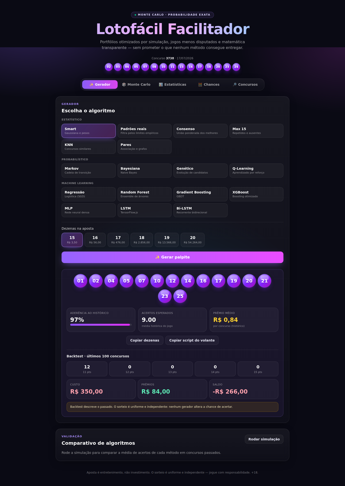
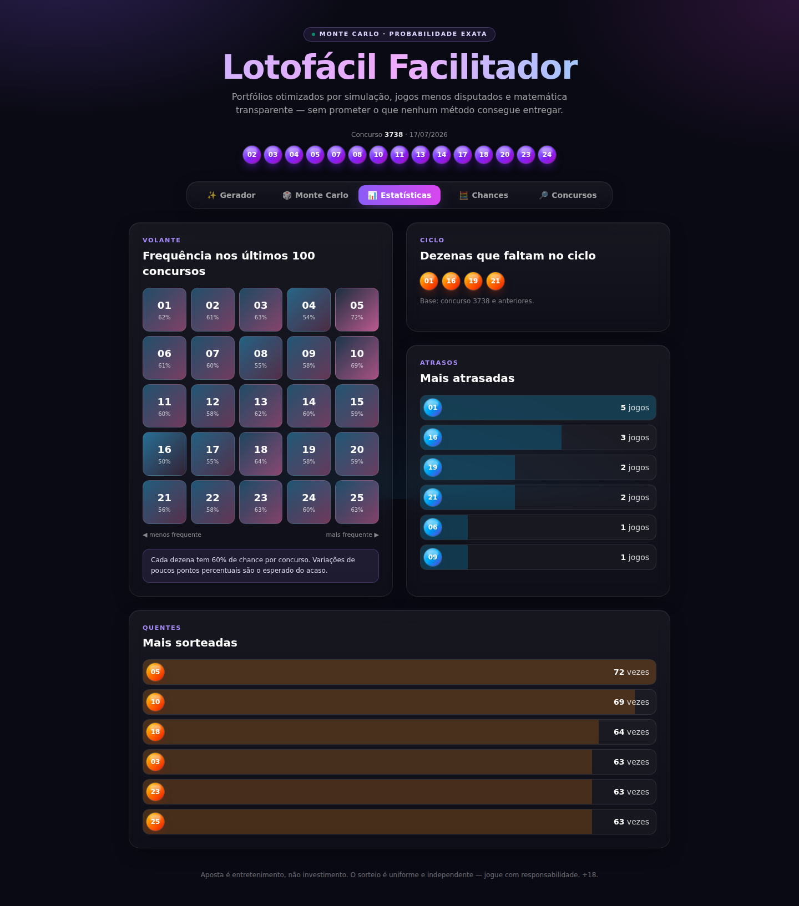
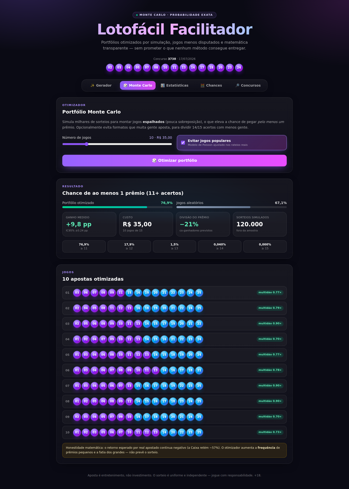
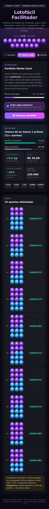

# Lotofácil Facilitador

Este projeto é uma aplicação web desenvolvida para auxiliar na geração e análise de números para a Lotofácil. Ele oferece geradores, análise estatística e simulação para escolher dezenas. Nenhum método prevê o sorteio (veja [A verdade matemática](#a-verdade-matemática-leia-antes-de-apostar)).

> **App:** https://juninmd.github.io/lotofacil-facilitador/



## Abas

| Aba | O que faz |
|---|---|
| ✨ Gerador | Gera jogos com 14 estratégias (heurísticas, Markov, ML, genético, ensemble) e desdobramento |
| 🎲 Monte Carlo | Portfólio de jogos com pouca sobreposição e jogos "menos disputados" |
| 📊 Estatísticas | Frequência, atrasos e dezenas faltantes no ciclo, com o último concurso |
| 🧮 Chances | Probabilidade exata (hipergeométrica) e custo por quantidade de dezenas marcadas |
| 🔎 Concursos | Busca de concursos anteriores |

| Estatísticas | Monte Carlo | Mobile |
|---|---|---|
|  |  |  |

## Tecnologias

React 19, TypeScript, Vite, Tailwind CSS 4, React-Bootstrap, TensorFlow.js (estratégias de ML), Vitest. Componentes de UI: [`@juninmd/sonido`](https://github.com/juninmd/sonido) (ver `docs/sonido-migration/`). Gerenciador de pacotes: **pnpm** (`pnpm-lock.yaml`).

## Como rodar

Requisitos: Node.js 22 (versão usada no deploy) e pnpm.

```bash
git clone https://github.com/juninmd/lotofacil-facilitador.git
cd lotofacil-facilitador
pnpm install
pnpm dev            # http://localhost:5173
```

### Scripts

| Comando | Uso |
|---|---|
| `pnpm dev` | Servidor de desenvolvimento (Vite) |
| `pnpm build` | `tsc -b` + build de produção em `dist/` |
| `pnpm preview` | Serve o build |
| `pnpm test` | Suíte determinística (Vitest) |
| `pnpm test:coverage` | Relatório de cobertura |
| `pnpm test:backtest` | Backtest e benchmarks com dados reais da Caixa (fora do CI) |
| `pnpm data:update` | Baixa o histórico completo para `src/data/lotofacil-history.json` (API comunitária, com fallback para a Caixa) |
| `pnpm lint` | ESLint (Requer atualização da configuração para suportar TypeScript 7) |

### Dados

O histórico fica versionado em `src/data/lotofacil-history.json`; `pnpm data:update` o atualiza. Não há variáveis de ambiente obrigatórias.

### Deploy

O deploy para produção roda automaticamente a cada push na branch `master`, publicando no GitHub Pages via o workflow `.github/workflows/pages.yml`. O `Vite` constrói o site com o caminho base `/lotofacil-facilitador/` (`vite build --base=/lotofacil-facilitador/`), que depois é publicado automaticamente pelo GitHub Actions.

Para fazer o deploy manualmente:

1. `pnpm build` — gera os arquivos em `dist/`
2. `pnpm preview` — visualiza localmente o build antes de publicar

O workflow `.github/workflows/pages.yml` cuida do restante: compila, comuta para a branch `gh-pages` e empurra os artefatos para o GitHub Pages.

Também há um workflow de `auto-merge-billing-blocked.yml` que garante que os checks de spending limit não bloqueiem o merge automático dos PRs.

## Monte Carlo & jogos menos disputados

Aba **Monte Carlo** (`src/utils/mc/`):

- **Portfólio otimizado**: busca local sobre sorteios simulados (números aleatórios
  comuns) escolhe jogos com pouca sobreposição. Recozimento simulado + troca de dezenas. Medido em 300 mil
  sorteios *fora da amostra*: P(≥1 prêmio) sobe de 43,5→49,4% (5 jogos), 67,1→77,4% (10) e 89,8→96,1% (20).
  Relatório completo em [`docs/HOMOLOGACAO.md`](docs/HOMOLOGACAO.md).
- **Modelo de multidão**: regressão de Poisson nos rateios reais (ganhadores de 14/15
  por concurso) mostra quais formatos de jogo são populares. Validado em hold-out
  temporal: jogos previstos "menos disputados" têm ~40% menos co-ganhadores no 14.
  Isso aumenta o prêmio *condicional* a acertar — não a chance de acertar.
- O retorno esperado por real continua negativo (~−57%): nenhum método prevê o sorteio.

## Loterias internacionais (sem dados brasileiros)

`src/utils/intl/` aplica a mesma perícia e a fórmula VPE a qualquer loteria *k de n* (Powerball 5/69, Mega Millions 5/70,
NY Lotto 6/59, Take 5, Cash4Life). Baixe os históricos públicos com `node scripts/fetch_intl.mjs` (requer acesso a
`data.ny.gov`) e rode `npx vitest run --config vitest.backtest.config.ts src/utils/intl` para gerar `docs/INTERNACIONAL.md`.
Validado em mundos sintéticos: sem viés nada é sinalizado; com viés injetado a frequência, a persistência e o VPE detectam.

## Perícia estatística e a fórmula VPE

`src/utils/forensics/` roda uma bateria de ~50 testes (frequências, pares, trios, dependência entre concursos,
ordem de saída das bolas, calendário, espectro, deriva, duplicatas, modelo de aprendizado grande) com p-valores exatos por
Monte Carlo. **Descoberta:** as dezenas têm um viés **real e persistente de ~±1 pp** (única coisa que sobrevive a Bonferroni;
correlação 0,48 entre metades do histórico). Tudo o mais é compatível com sorteio uniforme. A fórmula **VPE** (Bayes empírico,
`src/utils/bias/`) estima esse viés sem hiperparâmetros e vale ≈ +0,05 a +0,08 acertos/jogo (+~1 pp de P(≥11) por jogo);
combinada com o otimizador Monte Carlo, 10 jogos chegam a 78% de P(≥1 prêmio) em concursos reais fora da amostra.
Relatório completo, teste de poder e limites: [`docs/FORENSE.md`](docs/FORENSE.md).

## Laboratório de fórmulas

`src/utils/formulas/` testa **63 fórmulas** de escolha de dezenas (frequência, decaimento, atraso, Markov,
Bayes, hazard, regressão logística online, KNN, dia da semana, vizinhança no volante, pares, ensembles,
controles aleatórios) em walk-forward com Holm-Bonferroni. Resultado: **nenhuma supera o acaso**
(4/63 com p<0,05 contra ≈3,2 esperado). Relatório completo: [`docs/FORMULAS.md`](docs/FORMULAS.md).

O que funciona de verdade (mesmo custo, medido): jogos **espalhados** (+10 pp de P(≥1 prêmio) com 10 jogos)
e **menos disputados** (+~6-8% de retorno esperado). Fórmula própria **REA** (`mc/expectedReturn.ts`):
`REA = Σ P11..13·prêmio + P14·prêmio14/c + P15·pool·(1−e^{−λc})/(λc)`. Retorno segue negativo (≈ −60%);
com jackpot acumulado sobe, sem nunca ficar positivo. "Rotação cíclica" (comum em sistemas) é *pior* que aleatório.

## Homologação & Testes

O projeto usa **vitest**. Testes cobrem invariantes dos 14 geradores, funções
estatísticas puras, probabilidade exata (hipergeométrica) e desdobramento.

```bash
pnpm test            # suite determinística (entra no CI)
pnpm test:coverage   # relatório de cobertura
pnpm test:backtest   # backtest + mega-benchmark com dados REAIS da Caixa (fora do CI)
```

## A verdade matemática (leia antes de apostar)

A Lotofácil sorteia 15 de 25 dezenas de forma **uniforme e independente**. O
benchmark com dados reais (`pnpm test:backtest`) comprova:

- **Prever não funciona.** Todas as estratégias (heurística, Markov, ML, ensemble)
  e até a aposta aleatória empatam na esperança de **9,0 acertos** ao marcar 15
  dezenas. Sorteios passados não influenciam os futuros.
- **A única forma real de acertar mais números** é marcar mais dezenas — o que
  aumenta a probabilidade de forma exata, ao custo de mais combinações:

  | Dezenas | Esperança | P(≥14) | Custo (combinações × R$3,50) |
  |---:|---:|---:|---:|
  | 15 | 9,0 | ~0,03% | R$ 3,50 (1) |
  | 16 | 9,6 | maior | R$ 56 (16) |
  | 18 | 10,8 | maior | R$ 2.856 (816) |
  | 20 | 12,0 | maior | R$ 54.264 (15.504) |

- **Desdobramento** (wheeling) garante um número mínimo de acertos de forma
  **matemática** (não por sorte), distribuindo um pool em vários jogos.

⚠️ Aposta é entretenimento, não investimento. Jogue com responsabilidade.

## Contribuição

Contribuições são bem-vindas! Sinta-se à vontade para abrir issues ou enviar pull requests.

## Licença

Este projeto está licenciado sob a licença MIT.
