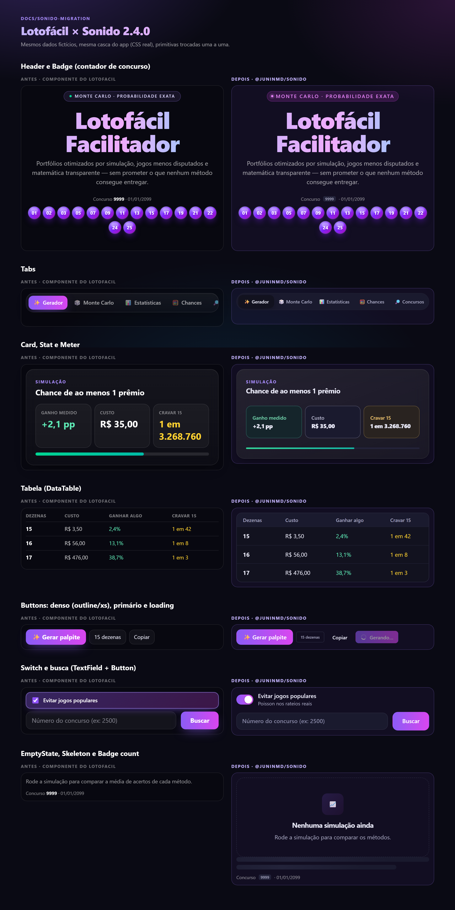
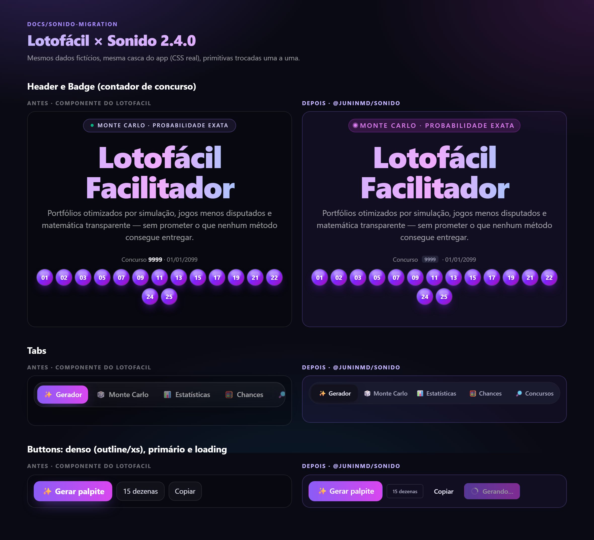

# Migração para `@juninmd/sonido` 2.4.0

Este diretório é a evidência da troca das primitivas desenhadas à mão no
lotofacil-facilitador pelas do design system, mantendo o tema "noite de
sorteio" (violeta/fúcsia) através de uma ponte de tokens.

- `preview.html` + `preview.tsx`: comparação **Antes · componente do lotofacil**
  × **Depois · @juninmd/sonido** usando o CSS real do app.
- `legacy/`: cópia literal dos componentes de `origin/master`
  (`git show origin/master:<path>`), só com os imports ajustados.
- `antes-depois.png` e `chrome-denso.png`: prints full-page em viewport
  1180×900 @2x (porta 5314).

## Prints





Os dois prints usam **dados fictícios** (concurso 9999, 01/01/2099).

## Mapa das trocas

| Primitiva | Antes (arquivo) | Depois (Sonido) | Onde aparece |
|---|---|---|---|
| Card | `section.card` em `src/components/ui.tsx` | `Card` + `CardHeader`/`CardTitle` | todos os painéis, via `ui.tsx` |
| Stat | `div` em `src/components/ui.tsx` | `StatTile` | Monte Carlo, resultado do gerador, viés VPE |
| Meter | `div role="progressbar"` em `ui.tsx` | `ProgressBar` | Monte Carlo (`otimizado` × `aleatório`), resultado |
| Spinner | SVG em `ui.tsx` | `Spinner` | carregamento do app |
| Tabs | tablist manual em `src/components/Tabs.tsx` | `Tabs variant="pill"` com `idPrefix`/`hasPanels` | navegação principal |
| Button | `.btn-primary`, `.btn-ghost`, `.chip` | `Button` (`primary`/`ghost`, `size`/`appearance`) | gerador, Monte Carlo, simulação, copiar, buscar |
| Button denso | chips de algoritmo/dezenas | `Button size="sm"` + `appearance="outline"`, ponte `.lc-algo`/`.lc-chip` | gerador |
| Badge | pill inline em `Header.tsx` | `Badge tone="violet" dot live` | topo |
| Badge count | `<strong>` do concurso | `Badge appearance="count"` | topo e apostas do Monte Carlo |
| TextField | `input.field` | `TextField` (label visualmente oculto) | busca de concurso |
| Switch | `label.chip` + checkbox | `Switch` | Monte Carlo (evitar multidão / usar VPE) |
| DataTable | `<table>` crua | `DataTable` | aba Chances |
| EmptyState | parágrafo | `EmptyState` | comparativo de algoritmos |

## Identidade preservada

`src/main.tsx` importa `@juninmd/sonido/styles.css` uma única vez, seguido de
`src/sonido-bridge.css` e `src/index.css`. O bridge mapeia os tokens do Sonido
para os do app:

- `--sn-color-accent` → `--color-brand` (`#8b5cf6`)
- `--sn-color-accent-2` → `--color-brand-2` (`#d946ef`)
- `--sn-color-bg`/surface → `--color-ink`/`--color-panel`
- `--sn-gradient` → gradiente violeta/fúcsia do app
- sucesso/alerta/perigo → `--color-gain`/`--color-warn`/`--color-loss`

`<html data-theme="dark">` acompanha o tema único do app.

## Verificação

```bash
pnpm build   # tsc -b && vite build — ok
pnpm lint    # eslint . — 0 erros (11 warnings de react-refresh, já existentes)
pnpm test    # vitest run — 18 arquivos, 151 testes, todos passam
```

Nenhum teste foi desabilitado ou removido. `nextTabId` e seu teste continuam
existindo como contrato WAI-ARIA; a navegação por setas/Home/End agora é feita
pelo `Tabs` do Sonido.

## Sem equivalente no Sonido (mantidos)

- `LotteryBall` (bola de loteria com relevo/gradiente).
- `Callout` (aviso informativo/âmbar do app).
- Grades 5×5 de frequência e viés, e as barras de fundo do ranking — são
  visualizações específicas do domínio.
